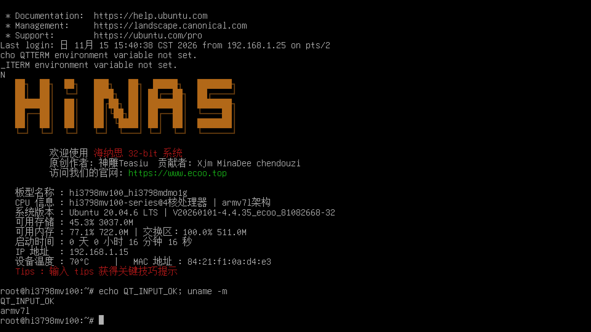

# lvfbterm

在 Linux 帧缓冲（`/dev/fb0`）上运行的本地伪终端。

- 显示：LVGL + Linux fbdev 驱动
- 字形：FreeType + Unifont
- 终端语义：libvterm
- 会话：`forkpty()` + `/bin/login`（默认）
- 输入：USB 键盘（evdev）+ 鼠标滚轮
- 语言：C++11 + C11，Makefile 构建

设计细节见 [DESIGN.md](DESIGN.md)。

## 两个版本

- **Qt 版（当前推荐）**：`bin/lvfbterm`，Qt 5 + QTermWidget + `linuxfb`。
  已在设备上实测登录、MOTD、命令执行；键盘走 Qt evdev 插件。源码在 `qt/`。
- **LVGL 版（legacy）**：`bin/lvfbterm-lvgl`，LVGL + FreeType + libvterm 自绘。
  源码在 `src/`；hifb 的 mmap 不参与扫描输出，需要 `write()` 刷屏（已配置）。

Qt 版没有使用 libvterm：QTermWidget 自带 VT 解析、PTY、滚动和选区。
如果必须保留 libvterm，继续用 LVGL 版或下一步做“Qt 窗口 + libvterm + QPainter”的混合版。




## 当前状态

已在 `192.168.1.15` 上跑通：

- `/dev/fb0`（hifb，1920×1080/32bpp）初始化、LVGL canvas、整屏 flush
- Unifont OTF 加载，ASCII/中文/框线/256 色/ANSI 备用屏幕由 libvterm 解析
- `/bin/login` 登录提示、登录后的 shell 与 MOTD 正常渲染
- `Ctrl+Alt+Q` 退出并恢复文本控制台

输入部分已识别到真实 USB 键盘（SIGMACHIP USB Keyboard → `/dev/input/event0`），
登录后按键链路待你实机确认。若仍有丢键，优先检查 `/dev/input/event*` 是否被其他进程 grab。

hifb 的 mmap 写不会自动上屏，每帧后必须调用私有 ioctl
`ioctl(fb, 0x4606, &vinfo)` 提交；旧项目里的 `lcd_refresh()` 就是这句。
本项目保留 `LV_LINUX_FBDEV_MMAP=1`，由 `Display::commitFb()` 在每帧后提交。

## 目标设备

`root@192.168.1.15`：

- Hi3798MV100 / armv7l / Ubuntu 20.04 armhf
- `/dev/fb0`：`hifb`，1920×1080，32bpp，XRGB8888
- 交叉工具链：`~/x-tools/arm-unknown-linux-gnueabihf/bin/arm-unknown-linux-gnueabihf-`

## 目录

```
.
├── Makefile
├── config/lv_conf.h        # 精简 LVGL 配置
├── src/                    # 主程序
├── tools/fb_probe.c        # 帧缓冲自检
├── scripts/deploy.sh       # 构建 + 打包 + 部署
├── assets/unifont.otf      # make 时从 tarball 解出
├── build/                  # 中间产物/依赖
└── bin/lvfbterm
```

## 依赖

同目录下需要：

- `lvgl/`（静态编译，链进主程序）
- `libvterm/`（编译成 `libvterm.so`）
- `freetype/`（编译成 `libfreetype.so`）

`unifont-18.0.01.tar.gz` 放在项目根目录，`make` 会解出 `assets/unifont.otf`。

## 构建

```sh
make -j4
```

默认使用：

```sh
$HOME/x-tools/arm-unknown-linux-gnueabihf/bin/arm-unknown-linux-gnueabihf-
```

可覆盖：

```sh
make -j4 CROSS_COMPILE=/path/to/arm-unknown-linux-gnueabihf-
```

产物：

```
bin/lvfbterm
build/deps/lib/liblvgl.a
build/deps/lib/libvterm.so*
build/deps/lib/libfreetype.so*
assets/unifont.otf
```

单独构建依赖：

```sh
make deps
```

## 部署

```sh
./scripts/deploy.sh
```

默认部署到 `root@192.168.1.15:/root/lvfbterm`，使用 ssh 自己的认证方式（密钥或交互密码）。目标机只需要 `sh` 和 `tar`，不需要 rsync。

目录结构：

```
/root/lvfbterm/
├── bin/lvfbterm
├── lib/libvterm.so*
├── lib/libfreetype.so*
└── share/unifont.otf
```

主程序带 `rpath=$ORIGIN/../lib`，直接运行即可找到两个 `.so`。

## 运行

```sh
ssh root@192.168.1.15
cd /root/lvfbterm
./bin/lvfbterm --font-path=share/unifont.otf
```

常用参数：

```
--fb=/dev/fb0            帧缓冲设备
--font-size=32           字号（8..96，默认 32）
--font-path=PATH         字体，可重复；第一个主字体，其余 fallback
--scrollback=5000        回滚行数
--shell=CMD              PTY 程序，默认 /bin/login
--keyboard=PATH          evdev 键盘，可重复
--mouse=PATH             evdev 鼠标，可重复
--log-level=debug        日志级别
```

## 快捷键

| 操作 | 行为 |
|---|---|
| `Ctrl+Alt+Q` | 退出程序，恢复文本控制台 |
| `Ctrl+滚轮` | 字号 ±2px，重算行列并发 `SIGWINCH` |
| 滚轮 | 程序开了鼠标上报 → 给程序；否则主屏幕滚回滚，备用屏幕发 ↑/↓ |
| 普通键 | 原样送入 PTY；`Ctrl+C`、`Ctrl+Z` 等不会被拦截 |
| `Shift+Tab`、方向键、F1-F12 | 按 xterm 序列送入 PTY |

`/bin/login` 注销后会自动重新拉起登录提示；`--shell=/bin/bash` 退出则整个程序退出。

## 字体

- 默认搜索 `./unifont.otf`、`./share/unifont.otf`、`../share/unifont.otf`、系统字体目录。
- 第一个是主字体，决定 cell 大小；后面的作为缺字 fallback。
- 等宽判定按“ASCII 半角步进一致、全角 2 倍”，兼容 Unifont 的 dual-width（fontconfig 里是 `spacing: 90`，不是 `mono`）。
- 主字体非等宽只告警，仍继续用，格宽取 `'M'`。
- 缺字画空心方块。
- 所有字体都加载失败时画空心方块（LVGL 内置字体回退尚未接到自绘管线）。
- 16 的整数倍字号用 1-bit 点阵渲染，其它字号用灰度抗锯齿。

## 调试

输入模拟（无物理键盘时）：

```sh
# 设备上需要 /dev/uinput；它会创建一个名为 lvfbterm-test-kbd 的虚拟键盘
make -C /home/xiaoyi/lvfbterm  # 主机上先构建
# 把 tools/uinput_type.c 交叉编译后放到设备上，例如：
~/x-tools/arm-unknown-linux-gnueabihf/bin/arm-unknown-linux-gnueabihf-gcc \
  -O2 tools/uinput_type.c -o build/uinput_type
scp build/uinput_type root@192.168.1.15:/root/lvfbterm/bin/
```

帧缓冲自检：

```sh
make probe
scp build/fb_probe root@192.168.1.15:/tmp/
ssh root@192.168.1.15 /tmp/fb_probe /dev/fb0
```

它会打印分辨率、像素格式、mmap、第二页写读、`FBIOPAN_DISPLAY` 结果，不会改变可见画面。

程序日志默认输出到 stderr，SSH 运行时直接可见；`--log-level=debug` 打开详细日志。

## 已知限制

- 暂不支持中文输入法（后续可接 libpinyinime，不用 LVGL 自带 IME）。
- 不支持鼠标点击/拖选/复制粘贴、超链接、Sixel/Kitty 图形。
- 不支持多标签/多窗口/状态栏。
- 缩放后回滚历史不重排，按新列宽裁剪/补空。
- 先手动运行，未提供 systemd unit。
- 键盘固定 US QWERTY。
