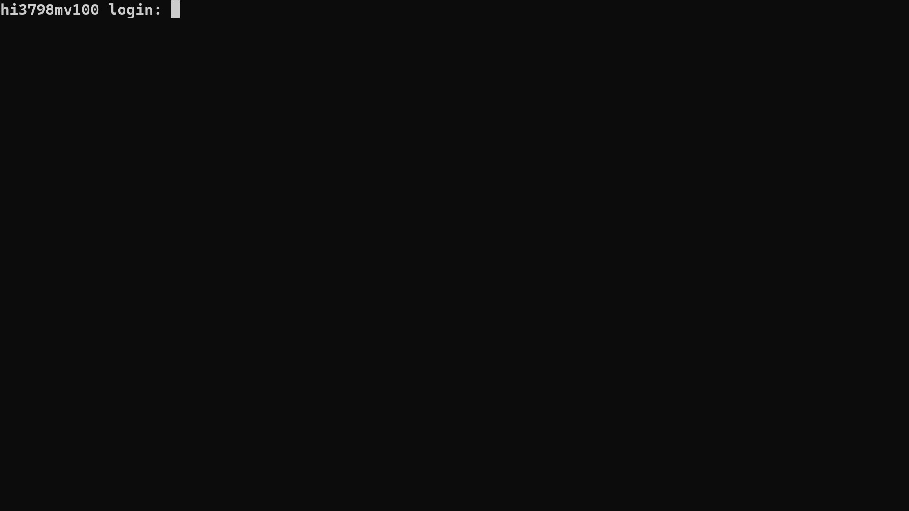
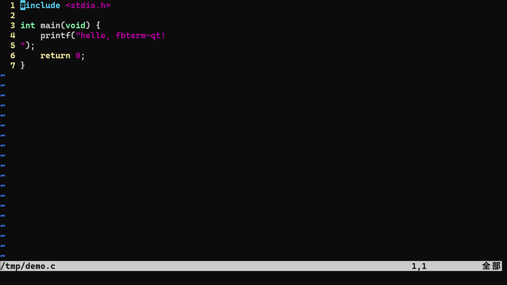

# 纯Vibe Coding警告！
特别鸣谢:Deepseek v4.1 flash

# fbterm-qt

一个可以在 Linux 帧缓冲 `/dev/fb0` 上运行的本地伪终端。<br>
其实只是为自己的机顶盒写的<br>
因为我不想每次都要ssh进去才能操作...

基于 **Qt 5 + QTermWidget**，使用 Qt 的 `linuxfb` 平台插件直接输出到帧缓冲设备

- 显示：Qt5 `linuxfb` → `/dev/fb0`
- 终端：QTermWidget（VT 解析、PTY、滚动、选区、鼠标上报）
- 字体：默认只找 `font.ttf` / `font.otf`（Qt 底层 FreeType）；没有则用 Qt 默认字体
- 配色：Windows Terminal **Campbell**（深色 `#0C0C0C`，非 Campbell PowerShell 蓝底）
- 输入：自管 evdev，`QSocketNotifier` + `EVIOCGRAB`，支持热插拔
- 中文输入：使用https://github.com/RobinNotBad/libpinyinime大佬的轻量级输入法，Shift 切换中英，空格/数字选词，全角标点
- 会话：`/bin/login`（默认）；登录 shell 里 `exit` 或注销后**直接退出程序**
- 语言：C++17，qmake 构建

## 截图






## 目录

```text
.
├── qt/                       Qt/QTermWidget 主程序
│   ├── main.cpp              linuxfb、字体、启动
│   ├── terminalwindow.*      窗口、字体、快捷键、候选浮层、toast
│   ├── ime.*                 libpinyinime 状态机、全角标点
│   ├── evdevinput.*          键盘/鼠标热插拔输入
│   ├── consolemode.*         KD_GRAPHICS / KD_TEXT
│   ├── signalbridge.*        SIGTERM → Qt quit
│   ├── vendor/pinyinime/     内置拼音引擎源码
│   └── fbterm-qt.pro
├── share/
│   ├── color-schemes/        Campbell.colorscheme
│   ├── keytab/               fbterm-qt.keytab
│   ├── pinyin.txt            拼音表
│   └── dictionary.data       词典
├── systemd/fbterm-qt.service
├── scripts/                  deploy.sh / install-service.sh
├── tools/                    fb_probe / uinput_type / fb_ffmpeg_bridge
├── docs/                     实机截图
├── GUIDE.md                  使用、调优、移植
├── DESIGN.md                 设计说明
└── Makefile
```


## 依赖

设备上：

```sh
apt-get install -y g++ qtbase5-dev qtbase5-dev-tools \
    libqtermwidget5-0-dev libutf8proc-dev
```

字体优先级：

1. `--font-path` 指定的字体最高；可重复，第一个是主字体，后续是 fallback：
   `--font-path=main.ttf --font-path=fallback.ttf`
2. 没有指定时，找 `./font.ttf` / `./font.otf` / `./share/font.ttf` / `./share/font.otf`
3. 都没有，使用 Qt 默认字体

输入法候选条和“中/EN”toast 复用当前终端字体。

## 构建

在目标机上原生构建：

```sh
cd /root/fbterm-qt/qt
./build.sh
```

产物：`../bin/fbterm-qt`。

从主机部署并构建：

```sh
./scripts/deploy.sh
```

## 运行

```sh
cd /root/fbterm-qt
./bin/fbterm-qt
```

参数：

```text
--font-path=PATH      字体文件；可重复，第一个主字体，后续 fallback
--font-size=N         8..96，默认 32
--shell=CMD           默认 /bin/login
--scrollback=N        默认 5000
--keyboard=PATH       指定键盘（默认自动扫描）
--mouse=PATH          指定鼠标（默认自动扫描）
--disable-ime         关闭内置中文输入法
```

快捷键：

- `Ctrl+Alt+Q` 退出，恢复文本控制台
- `Ctrl+滚轮` 字号 ±2px


## 中文输入法

默认启用，使用 `share/pinyin.txt` 和 `share/dictionary.data`，不需要额外服务。

- `Shift` 单击：切换中文/英文（不显示中英图标）
- 中文模式字母：输入拼音，库自动分音节，例如 `zhendema` → `zhen'de'ma`
- 选“真”后剩余 `de'ma` 会继续显示/参与候选，不会丢掉已选的字
- `空格`：选当前页第 1 个候选
- `1`-`9`：选当前页对应候选
- `→`：下一页候选；`←`：上一页；还有下一页时末尾显示 `->`
- `Backspace`：删除一个拼音字母
- `Esc`：清空当前拼音
- `Enter`：把当前拼音原样提交
- 中文模式标点：自动转全角（`，。？！：；（）【】《》` 等）
- 切换中英时，右下角短暂弹出 `中` / `EN`（1.2 秒，不常驻图标）
- 关闭：`--disable-ime`，或 `systemctl edit fbterm-qt.service` 加 `ExecStart` 参数

## 输入热插拔

输入层不依赖 Qt 的 evdev 通用插件，而是自己读 `/dev/input/event*`：

- **没有键盘时每 500ms 扫描一次**；找到键盘后停止扫描
- **鼠标每 10s 扫描一次**
- 键盘拔掉时 `read()` 返回 `ENODEV` → 关闭 fd、删 `QSocketNotifier`；
  如果没有键盘了，重新进入 500ms 扫描
- 每个设备都 `EVIOCGRAB`，避免 tty1/fbcon 再收一份键
- 按键合成 `QKeyEvent` 发给 `TerminalDisplay`
- 滚轮合成 `QWheelEvent`


## 显示

- 启动时对 `/dev/tty0` 执行 `KDSETMODE(KD_GRAPHICS)`，阻止 tty1 fbcon 叠加；
  退出时恢复 `KD_TEXT`
- 不在启动时探测 Qt 通用 evdev 插件，避免和 tty1/SSH stdin 形成第二路输入
- hifb 的 mmap 不参与扫描输出；Qt linuxfb 走自己的刷新路径，已实测可显示


